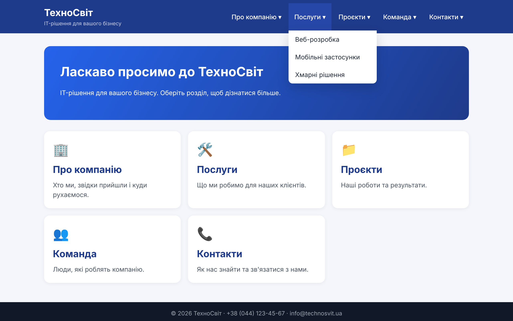
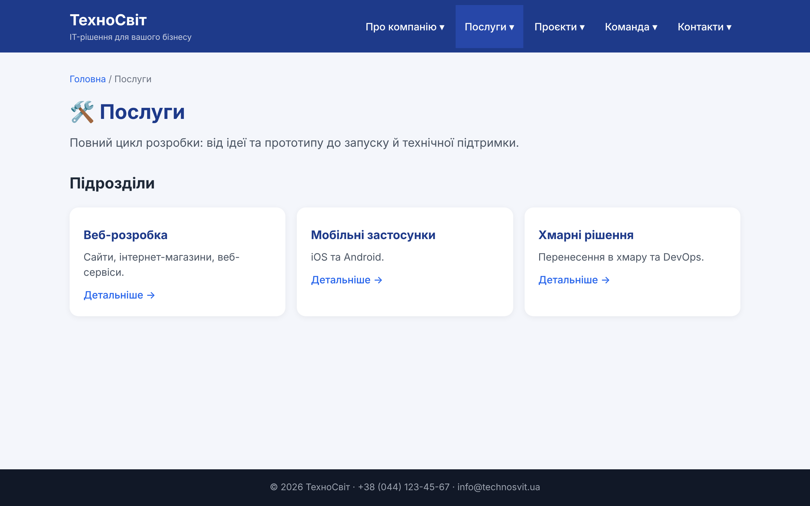
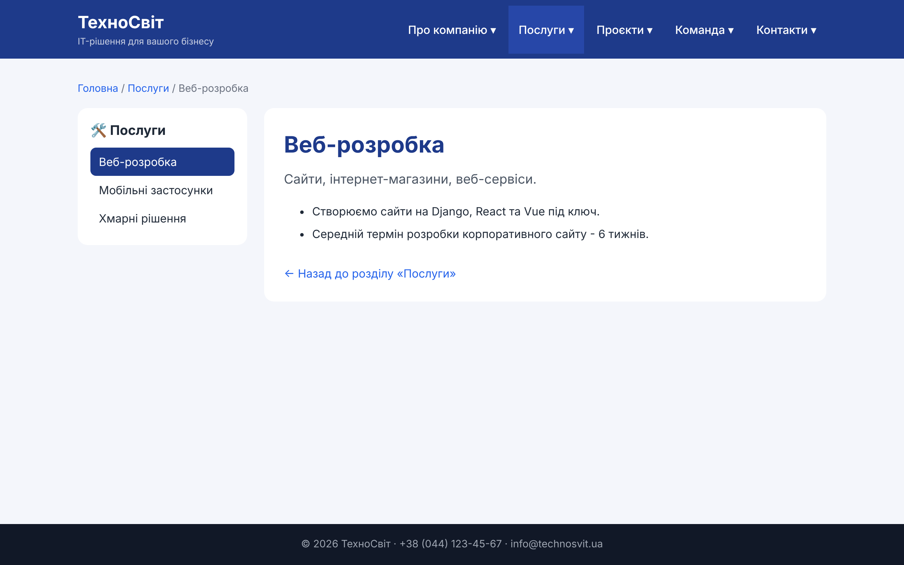

# Django: Моя компанія (ТехноСвіт)

Сайт компанії з 5 розділами, до кожного з яких додано підрозділи.

## Що зроблено

- **5 розділів** (додаток `main`): Про компанію, Послуги, Проєкти, Команда, Контакти.
- **Підрозділи** винесені в **окремий додаток `subsections`** - по 3 підрозділи в кожному розділі (15 сторінок).
- Усі контролери - **на класах** (class-based views, `TemplateView`):
  - `main.views.HomeView` - головна сторінка;
  - `main.views.SectionView` - сторінка розділу зі списком його підрозділів;
  - `subsections.views.SubsectionView` - сторінка підрозділу з боковим меню.
- Випадне меню з підрозділами в шапці (context processor `main.context_processors.menu`).
- Хлібні крихти: Головна / Розділ / Підрозділ.
- Неіснуючий розділ або підрозділ повертає 404.

| Розділ | Підрозділи |
|---|---|
| Про компанію `/about/` | Історія, Місія та цінності, Нагороди |
| Послуги `/services/` | Веб-розробка, Мобільні застосунки, Хмарні рішення |
| Проєкти `/projects/` | Портфоліо, Кейси, Відгуки клієнтів |
| Команда `/team/` | Керівництво, Розробники, Вакансії |
| Контакти `/contacts/` | Офіси, Зворотний зв'язок, Як дістатися |

## Структура

```
config/                     # налаштування та головні urls.py
main/                       # головна + 5 розділів
├── data.py                 # дані розділів
├── views.py                # HomeView, SectionView
├── urls.py
├── context_processors.py   # меню
├── templates/main/         # base.html, home.html, section.html
├── static/main/style.css
└── tests.py
subsections/                # окремий додаток для підрозділів
├── data.py                 # дані підрозділів
├── views.py                # SubsectionView
├── urls.py                 # /<розділ>/<підрозділ>/
└── templates/subsections/subsection.html
manage.py
```

## Запуск

```bash
pip install -r requirements.txt
python manage.py migrate
python manage.py runserver
```

Відкрити http://127.0.0.1:8000/

Тести: `python manage.py test`

## Скріншоти

### Головна сторінка


### Випадне меню з підрозділами


### Розділ «Послуги» зі списком підрозділів


### Підрозділ «Веб-розробка»


### Підрозділ «Історія»


### Розділ «Команда»

